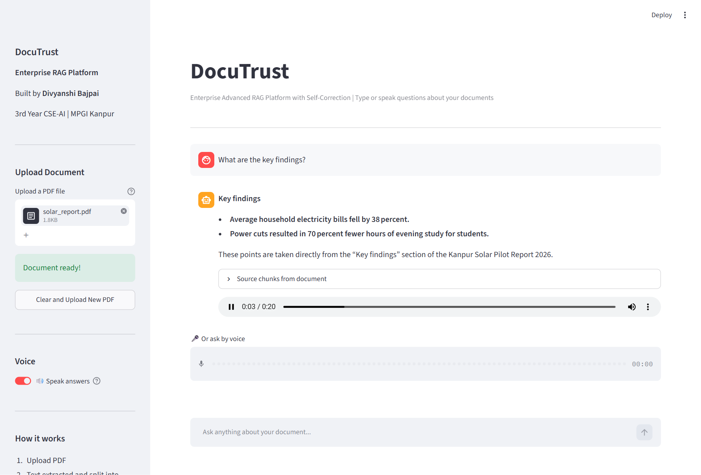

# DocuTrust — Voice-Enabled Corrective-RAG Platform

Ask questions about any PDF by typing or speaking, and hear the answer read aloud. Answers come only from your document, with the source chunks shown, and a self-correcting (CRAG) retrieval step checks that the retrieved text is actually relevant before answering.

**Live demo:** https://doctrust-atk3zvb5pvvuzskgshba5s.streamlit.app



## Features

- **Voice in, voice out:** ask by microphone (Groq Whisper speech-to-text) and hear the answer spoken back (gTTS, with Hindi output for Devanagari answers). Can be switched off in the sidebar.
- **Corrective RAG (CRAG):** an LLM grades whether the retrieved chunks are relevant; if not, it rewrites the query and retrieves again before answering.
- **Grounded answers with citations:** the model answers only from the document and shows the source chunks it used.
- **One pipeline for every input:** typed, spoken and suggested questions all go through the same `answer_question()` function, so text and voice can't drift apart.
- **Per-upload isolation:** each PDF is indexed into its own in-memory ChromaDB collection, so earlier documents (or other users' documents) never leak into answers.

## How it works

```
🎤 speech ──► Whisper (STT) ──┐
⌨️ typed question ────────────┼──► embed ──► ChromaDB similarity search ──► relevance grader
                              │                                             │ relevant   │ not relevant
                              │                                             ▼            ▼
                              │                                          answer    rewrite query → search again → answer
                              │                                             └────────────┬──────────────┘
                              │                                                          ▼
                              └──────────────────────────────── answer + source chunks ──► gTTS (TTS) ──► 🔊
```

## Tech stack

- Python, Streamlit, LangChain
- ChromaDB (vector store), FastEmbed (embeddings)
- Groq API: `openai/gpt-oss-120b` (answers, grading, query rewriting), `whisper-large-v3-turbo` (speech-to-text)
- gTTS (text-to-speech)

## Run locally

```bash
pip install -r requirements.txt
```

Add your Groq API key to `.streamlit/secrets.toml` (git-ignored):

```toml
GROQ_API_KEY = "your-key-here"
```

```bash
streamlit run app.py
```

## Changelog

- **Oct 2026:** added voice input/output; moved the RAG pipeline into one shared function; fixed suggested-question buttons that never produced an answer; fixed chunks from previously uploaded PDFs leaking into answers (shared persistent ChromaDB collection → per-upload collection); switched the LLM from the retired `llama-3.3-70b-versatile` to `openai/gpt-oss-120b`.

## Built by

Divyanshi Bajpai | CSE-AI | MPGI Kanpur
